# 🔐 Awesome Enterprise Password Management & Privileged Access Management (PAM)

  

  
  
  
  
  
  

---

## ⚡ Top Enterprise Password Management & Privileged Access Ecosystem

> 🎯 **A comprehensive, curated directory of top-tier SaaS platforms and self-hosted open-source GitHub projects for enterprise credential vaults, secrets rotation, zero-standing-privilege models, and Just-In-Time (JIT) PAM bastions.**

This repository tracks battle-tested solutions helping DevOps, SecOps, and IT infrastructure teams protect crown-jewel infrastructure, satisfy stringent compliance mandates (SOC 2, ISO 27001, HIPAA, PCI-DSS), eliminate credential sprawl, record administrative SSH/RDP sessions, and enforce Zero Trust access control.

---

## 📑 Table of Contents
- [📊 Sector Overview & Market Dynamics](#-sector-overview--market-dynamics)
- [☁️ SaaS & Commercial Enterprise Platforms](#️-saas--commercial-enterprise-platforms)
- [🔓 Open-Source GitHub Projects](#-open-source-github-projects)
- [🛠️ Architectural Guidance: EPM vs. PAM Bastions](#️-architectural-guidance-epm-vs-pam-bastions)
- [🤝 How to Contribute](#-how-to-contribute)
- [💖 Support & Sponsorship](#-support--sponsorship)
- [📈 Star History](#-star-history)
- [⚠️ Disclaimer](#️-disclaimer)

---

## 📊 Sector Overview & Market Dynamics

The enterprise identity security domain is experiencing rapid convergence across secrets management, credential vaults, and infrastructure access gateways:

* **Market Size & Trajectory**: The global **Privileged Access Management (PAM)** market is valued at approximately **$4.5B–$5.5B** (~21% CAGR through 2026), while the **Enterprise Password Management (EPM)** market stands at **$3.0B–$4.0B** (~18–20% CAGR). Growth is heavily catalyzed by cyber insurance prerequisites, Zero Trust mandates, and non-human identity (service accounts, API tokens, CI/CD runners) proliferation.
* **Market Concentration**:
  * **PAM (Consolidated Oligopoly)**: Highly concentrated around legacy and enterprise-first vendors (CyberArk, BeyondTrust, Delinea) commanding mission-critical compliance contracts, alongside fast-moving identity-native modern disruptors.
  * **EPM (Moderately Fragmented)**: Characterized by competitive differentiation between zero-knowledge independent vault providers (1Password, Bitwarden, Keeper) and native productivity suites.

---

## ☁️ SaaS & Commercial Enterprise Platforms

| Product | Description | Company Size / Valuation / Revenue | Pricing (Starting) | Free Tier / Trial Limits |
|:---|:---|:---|:---|:---|
| **[CyberArk](https://www.cyberark.com/)** | 🛡️ **Enterprise PAM industry pioneer** delivering Privileged Cloud vaulting, credential rotation, session isolation, and endpoint privilege security for complex compliance environments. | **~$22.5B - $25B valuation** (Acquired by Palo Alto Networks for ~$25B; ~$1.36B revenue) | Privilege Cloud: Starting at **~$600 - $1,500/user/year** (annual enterprise commitments often starting at ~$30,000+) | **No self-service free tier**; 14 to 30-day guided Proof of Concept (PoC) evaluation available via enterprise sales. |
| **[Zoho Vault](https://www.zoho.com/vault/)** | 💼 **Integrated team password manager** within the Zoho business ecosystem featuring audit logs, role-based sharing, and automated password changes. | **~$12.5B valuation** (Zoho Corp; ~$1.4B - $1.5B annual revenue) | Standard: **$0.90/user/month** (billed annually) or $1.00/user/month (monthly); Professional: **$4.00/user/month** (annual) | **Free forever plan**: 1 user only, unlimited passwords and passkeys across unlimited devices, 2 MB attachment limit (no team sharing/admin controls). 15-day free trial for paid tiers. |
| **[1Password Business](https://1password.com/)** | 🔑 **Enterprise credential vault** with polished cross-platform UX, Travel Mode, fine-grained access vaults, SIEM audit integrations, and developer CLI. | **~$6.8B valuation** (~$500M+ ARR) | Teams Starter: **$24.95/month** (flat rate up to 10 users); Business: **$8.99/user/month** (billed annually) | **14-day free trial** (full business feature set; no permanent free tier). |
| **[BeyondTrust](https://www.beyondtrust.com/)** | 🔒 **Integrated PAM and Remote Access platform** delivering Password Safe credential management, Privileged Remote Access (PRA), and Endpoint Privilege Management. | **~$1.5B+ valuation** (~$400M - $500M ARR; Francisco Partners PE-backed) | Privileged Remote Access: Starting at **~$2,000+/named user/year** (or ~$1,995/month base packages; typical entry contracts ~$17,000+/year) | **14-day free trial** (available for Remote Support / Privileged Remote Access; demo/PoC required for Password Safe). |
| **[Delinea (Secret Server)](https://delinea.com/)** | 🏢 **Enterprise secrets management & PAM suite** (formerly Thycotic & Centrify) specializing in automated discovery, rotation, session recording, and credential proxying. | **~$1B+ valuation** (~$400M ARR; TPG Capital / Insight Partners PE-backed) | Secret Server Cloud: Starting at **~$8 - $12/user/month** (billed annually; platform entry minimums often apply) | **30-day free trial** (up to 10 users in cloud environment; no permanent free tier). |
| **[Bitwarden](https://bitwarden.com/)** | 🌐 **Open-source-rooted enterprise credential vault** with zero-knowledge AES-256 encryption, SCIM provisioning, custom roles, SSO integration, and independent security audits. | **Private (~$100M+ funding raised)** (Fast-growing private entity backed by PSG & Battery Ventures) | Teams: **$4/user/month** (annual); Enterprise: **$6/user/month** (annual) | **Free forever plan**: Unlimited vault items, 2-user sharing with 1 organization, 2-step login, sync across unlimited devices. Paid plans offer a 7-day free trial. |

---

## 🔓 Open-Source GitHub Projects

Sorted in descending order by GitHub stargazer popularity. All entries feature a direct live badge linking to the repository's stargazers.

| Project | Star Badge | Description |
|:---|:---:|:---|
| **[Vaultwarden](https://github.com/dani-garcia/vaultwarden)** |  | 🦀 **Lightweight Rust-based Bitwarden alternative.** Compatible with all official Bitwarden web vaults, extensions, and mobile apps. Extremely low resource footprint, ideal for self-hosted sovereign infrastructure and small teams. |
| **[JumpServer](https://github.com/jumpserver/jumpserver)** |  | 🚀 **Complete open-source PAM bastion platform.** Brokers, audits, and records access to SSH, RDP, Kubernetes clusters, databases, and web applications. Features built-in credential vaulting, multi-factor authentication, and multi-tenant RBAC. |
| **[Infisical](https://github.com/Infisical/infisical)** |  | ⚡ **Open-source secret management & PAM platform.** Provides automated secrets synchronization across environments, dynamic Just-In-Time (JIT) access, machine identity management, and audit logging for engineering teams. |
| **[KeePassXC](https://github.com/keepassxreboot/keepassxc)** |  | 🛡️ **Cross-platform offline password manager.** Local-first, community-driven fork of KeePass with modern Qt UI, KeePassXC-Browser integration, SSH Agent forwarding, auto-type, and zero cloud dependency. |
| **[Teleport](https://github.com/gravitational/teleport)** |  | 🛰️ **Identity-aware zero-trust access plane.** Replaces static SSH keys, VPNs, and shared passwords with ephemeral certificate-based credentials for servers, Kubernetes, databases, Windows desktops, and internal web applications. |
| **[Bitwarden Server](https://github.com/bitwarden/server)** |  | 🏢 **Official backend for the Bitwarden platform.** Written in C# (.NET Core), providing enterprise-grade multi-organization password management, directory sync, SSO SAML 2.0/OIDC login, and compliance reporting. |
| **[OpenBao](https://github.com/openbao/openbao)** |  | 🏺 **Open-source community-governed secrets & PAM vault.** Forked under the Linux Foundation to provide open-governance secrets storage, transit encryption, and dynamic, short-lived privileged credentials. |
| **[Warpgate](https://github.com/warp-tech/warpgate)** |  | 🚪 **Zero-overhead smart bastion gateway.** Self-hosted proxy for SSH, HTTPS, and MySQL/Postgres targets that requires no specialized client applications. Offers recorded web sessions and live terminal replay. |
| **[Passbolt](https://github.com/passbolt/passbolt_api)** |  | 🔐 **Security-first team password manager with PGP end-to-end encryption.** Community Edition is 100% free with unlimited users, fine-grained access control, browser extension integration, and full REST API automation. |
| **[HashiCorp Boundary](https://github.com/hashicorp/boundary)** |  | 🌐 **Identity-based privileged access management.** Grants secure session access to infrastructure hosts and cloud endpoints without exposing the underlying private network or distributing static credentials. |
| **[Apache Guacamole](https://github.com/apache/guacamole-server)** |  | 🖥️ **Clientless remote desktop gateway.** Fully browser-based proxy supporting SSH, RDP, and VNC without client software. Offers screen recording, wake-on-LAN, and unified authentication via LDAP/SAML. |
| **[Padloc](https://github.com/padloc/padloc)** |  | ✨ **Modern, intuitive self-hosted password manager.** Minimalist user experience built on AES-GCM encryption, packed in a single lightweight Docker container designed for non-technical teams and individuals. |
| **[Teampass](https://github.com/nilsteampassnet/TeamPass)** |  | 📁 **Collaborative self-hosted password manager.** Designed specifically for IT and sysadmin departments to organize corporate passwords in hierarchical tree structures with fine-grained folder permissions. |
| **[ShellWarden](https://github.com/Boreas37/shellwarden)** |  | 🛡️ **Lightweight Go-based PAM bastion.** Features web SSH & RDP console access, time-boxed JIT access requests, SSH Certificate Authority (CA) issuance, append-only hash-chained audit trails, and live session shadowing. |

---

## 🛠️ Architectural Guidance: EPM vs. PAM Bastions

Choosing between an **Enterprise Password Manager (EPM)** and a **Privileged Access Management (PAM)** solution depends on your threat model and workflow boundaries:

* **Team Password Managers (EPM)** (*Passbolt, Vaultwarden, Bitwarden, KeePassXC*):
  * **Core Functionality**: Protect human-to-app credentials, shared corporate logins, passkeys, and API keys with client-side end-to-end encryption.
  * **Deployment Recommendation**: Deploy across all workforce employees to eliminate plaintext password storage and credential sharing over unencrypted channels (chat, email).
* **PAM & Bastion Gateways** (*JumpServer, Teleport, Warpgate, CyberArk, BeyondTrust*):
  * **Core Functionality**: Broker protocol-level access (SSH, RDP, K8s API, database sessions) without passing static root credentials to operators. Enforce Just-In-Time (JIT) approvals, auto-rotate administrative passwords, and record full terminal/graphical sessions for compliance audits.
  * **Deployment Recommendation**: Restrict strictly to infrastructure engineers, DevOps, and site reliability administrators managing production environments.

---

## 🤝 How to Contribute

Contributions are welcome! Help us expand this curated ecosystem:

1. 🍴 **Fork the repository** on GitHub.
2. 🌿 **Create a feature branch**: `git checkout -b feature/new-pam-tool`.
3. 📝 **Add or update an entry** in `README.md` maintaining proper table structure, live star badges, and factual descriptions.
4. 🚀 **Submit a Pull Request** with a concise description of the addition or update.

---

## 💖 Support & Sponsorship

If you find this curated ecosystem directory helpful in securing your infrastructure and selecting the right password and PAM platforms, please consider showing your support:

* ⭐ **Star this repository** to help other security engineers discover it.
* 🍴 **Fork and share** with your DevOps and SecOps networks.
* ☕ **Support the maintainer**: Sponsor on the [GitHub Sponsors Dashboard](https://github.com/sponsors/ishandutta2007) to help fund continued maintenance of open-source security collections!

---

## 📈 Star History

---

## ⚠️ Disclaimer

- This curated list is maintained for educational and informational purposes only; inclusion does not constitute a formal commercial endorsement.
- PAM platforms and password vaults safeguard the critical root credentials of your organization. Always enforce strict Multi-Factor Authentication (FIDO2 / WebAuthn), maintain offline encrypted backups of vault datastores, and audit bastion exposure.
